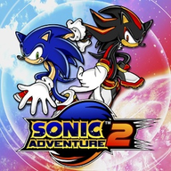

<div align=center>



</div>
<h1 align=center>sa2-nx installer</h1>

The installer page of [sa2-nx](https://github.com/ChanseyIsTheBest/sa2-nx), the native Nintendo Switch port of
Sonic Adventure 2: **https://chanseyisthebest.github.io/sa2-nx-installer/**

You give it your own copy of the Xbox Live Arcade game (its content package, or a folder you extracted it into) and it
gives you `sa2-nx.zip`, ready to extract to the root of the SD card. Everything runs in your browser (Chrome or Edge
recommended): the game files never leave your computer, and none of them come with sa2-nx.

From sa2-nx 1.0.7 the page is a copy of culdcept-nx-installer (renut_nx_ultimate_installer, the installer of the
ultimate base the sibling ports share), with SA2's `game.json`, colours, icon and `release/`. 1.0.6 and earlier were
made by the earlier page, which is in this repository's history.

## What it does

1. Finds the game in what you chose: the content package `525E7BB1E72A2DB99AB79281BA24938048198FAD58` (read in
   place with `lib/stfs.js`, nothing is extracted to disk), the `58411202` folder of an Xbox 360's `Content` folder, or
   an extracted game with its `default.xex`. The **Battle** DLC package, `SonicAdventure2Battle`, is optional.
2. Identifies the game by the SHA-256 of `default.xex`, picks its build from `release/manifest.json` and checks that
   every game file the build needs is there with its size.
3. Downloads that build's NRO and `LICENSES.txt` and checks their SHA-256.
4. Makes the game's shaders from its own files: the containers in `default.xex` and in `Shader/`, Renut's translator
   (`wasm/renut_hlsl`), DXC, SPIRV-Cross and the port's own Python passes run unchanged in Pyodide (`py/`), into
   `deko3d_glsl.bin`. The console compiles each shader variant at first use.
5. Re-encodes the movies to H.265 with the browser's encoder (WebCodecs): the 31 Sofdec movies (`.sfd`) as
   `NAME.sfd.hevc` (`lib/sfdh.js`, at 35 % of the MPEG-1 video's bitrate), packed with ZXC, and the two interviews
   (`.wmv`) as H.265 in their ASF files. The console decodes them on its video hardware. A browser without an H.265
   encoder, or the option unticked, keeps the original movies, which the port still plays.
6. Re-encodes the music (`gd/ADX/*.adx`) to Opus with the browser's encoder: SA2's own ADX decode (`lib/adx.js`), a
   resampler to 48 kHz, 128 kbit/s stereo, written as `NAME.adxo`. The voices and sound effects stay as they are.
7. Compresses the other game files with LZ4 HC in blocks (`NAME.lz4b`), which the port reads as if they were the
   originals.
8. Writes all the game files as one asset pack, `game_root.nxpack` with its index `game_root.nxidx` (the port's
   version 3, `lib/nxpack.js`), which the console mounts without scanning a folder.
9. Streams the zip to disk through the service worker, so the package never has to fit in memory.

The zip holds `switch/sa2-nx/` with `sa2.nro`, `LICENSES.txt`, `deko3d_glsl.bin`, `game_root.nxpack`,
`game_root.nxidx` and, if you chose it, `dlc/` with the Battle DLC: about 1.2 GB from the game's 2.4 GB. It holds no
`sa2.toml`: the game writes it at its first start, so a new zip never overwrites your settings.

## Layout

| Path | Contents |
|---|---|
| `index.html`, `app.js` | The page and its interface |
| `game.json` | What this game needs: its package name, the packing rules, the movies' and the music's re-encode, the page's texts |
| `worker.js` | Builds the package off the main thread (`lib/install.js`) |
| `glsl_worker.js`, `uam_worker.js`, `movie_worker.js`, `audio_worker.js`, `pack_worker.js` | The worker pools: shaders, the console's shader compiler (unused by SA2), movies, music, LZ4 and ZXC |
| `sw.js` | The download stream |
| `lib/` | The game's readers (Xbox Live package, XEX, title update), the shader chain, the movie and music writers, the LZ4 block files, the asset pack and the zip writer |
| `py/` | The port's shader passes, run in Pyodide |
| `wasm/` | WebAssembly builds: Renut's translator, DXC, SPIRV-Cross, uam, LZ4, ZXC, the MPEG-1, WMV3 and XMA decoders, the LZX decoder; `wasm/src/` has their sources and build scripts |
| `vendor/pyodide/` | Pyodide 0.27.7 with numpy |
| `release/` | The list of builds, the translator's header (`shader_common.h`) and the NRO's licenses |
| `test/` | Node scripts and browser pages that run the same code as the page |
| `tools/` | `make_release.py` (fills `release/` from the port's build) and the game file list |

## Deployment

The NRO is not stored here: it is the `sa2.nro` asset of a release of the sa2-nx repository of the same owner. The
workflow in `.github/workflows/deploy.yml` downloads it from the latest release, checks its SHA-256 against
`release/manifest.json` and publishes the page on GitHub Pages. It runs on every push to `main`; after publishing a new
release, run it by hand from the Actions tab. Pages must be set to deploy from GitHub Actions.

To publish a new build, put its NRO in `release/sa2.nro` (built with `-DBANJO_RENUT_RELEASE_SHADERS=ON`: no game
shader in it) and update the build's entry in `release/manifest.json`: `tools/make_release.py` fills it from the port's
tree, and `test/full_node.mjs --reference` adds the shader files' SHA-256 made from your own copy.

## Testing locally

Put `sa2.nro` in `release/` and serve the folder (any static server works; this one sets the right headers):

```sh
python serve.py 8193
```

Then open http://127.0.0.1:8193/. The same build runs in Node (without the movies' and music's re-encode, which need
the browser's encoders), and `test/check_zip.py` checks a zip against the game:

```sh
node test/full_node.mjs <game folder> sa2-nx.zip [--dlc=<folder>] [--no-pack]
python test/check_zip.py sa2-nx.zip <game folder>
```

The zips and everything the tests write are made from your game: never commit or share them.

## License

GPL-3.0 (see [LICENSE](LICENSE)). Third-party components are listed in [NOTICES.md](NOTICES.md); the licenses of the
NRO and its libraries are in [release/LICENSES.txt](release/LICENSES.txt). The page is built on
[nfsmw-nx-installer](https://github.com/StevensND/nfsmw-nx-installer) by StevensND.

Sonic Adventure 2 and Sonic the Hedgehog are trademarks of SEGA; the icon artwork is © SEGA. This project is not
affiliated with or endorsed by SEGA, Nintendo or Microsoft.
